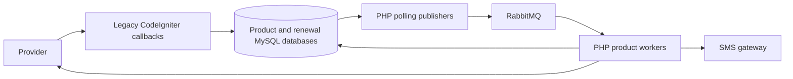
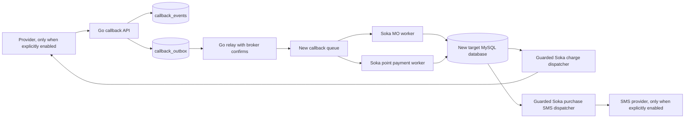

# Architecture decision draft

## Confirmed source boundaries

The source repository at `/Users/dany/Projects/work/YAS-SOKA-ISHIKISTAA-MEGAPROMO` is PHP, with CodeIgniter callbacks and separate Soka, Ishikistaa, and MegaPromo CLI workers. MySQL and RabbitMQ are configured. The production schema, DB version, traffic, and deployed process list have not been supplied.

## Target composition

Keep one Go codebase with distinct callback and worker processes. Product packages own rules; shared packages own transport, storage, configuration, and telemetry. Keep MySQL and RabbitMQ until measured evidence justifies replacing them. Introduce a new callback inbox and transactional outbox before migrating any legacy data. The new callback events queue is separate from legacy queues so messages cannot be consumed by incompatible PHP workers.

## Tradeoffs and acceptance gates

| Decision | Rationale | Remaining gate |
|---|---|---|
| Modular monolith, separate processes | Preserve product ownership without distributed service overhead | Verify team and deployment topology |
| Stay on MySQL | Existing data and SQL are MySQL-specific | Verify server version and operational limits |
| New inbox/outbox | Atomically accept callback and queue intent | Test on production-like MySQL and RabbitMQ |
| At-least-once queue delivery | Broker publish and database mark cannot be one transaction | Consumers must deduplicate by event ID |
| Preserve external callback paths and success shape | Reduce provider change risk | Compare captured production examples, including failures |
| Do not reuse legacy queues yet | Existing workers expect different payloads | Implement and test product-specific translators/workers |
| Keep dated legacy tables initially | Avoid unverified historic data movement | Inventory all physical tables and retention rules |

The callback API currently supports the three core JSON routes. The isolated Soka point-purchase database path creates a pending charge, then records a matched payment result and point award. Charge and SMS submission have explicitly enabled adapters tested only with fake providers. SMS acceptance does not prove handset delivery. M-Push, TigoPesa XML/JSON, most MO and payment paths, renewals, questions, prizes, and reporting are not migrated. Do not route production traffic to this service yet.
