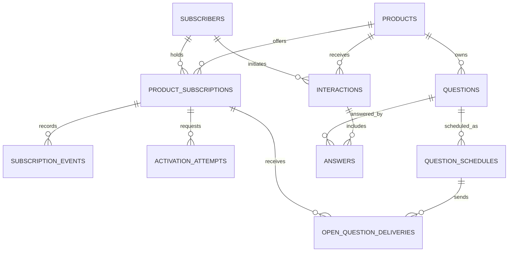
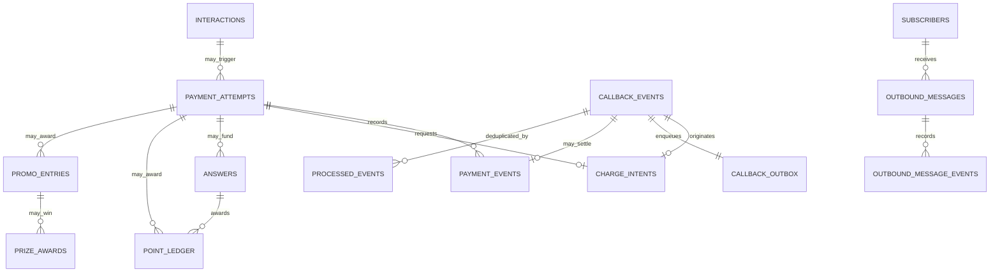

# Target database architecture

This is a **new target schema**, not a reconstructed ERD of the production databases. The source PHP code uses MySQL, but its live schema, version, data quality, and volumes have not been supplied. The four versioned SQL files were validated in a disposable, network-isolated MySQL 8.4 container. They have not been applied to production or to the PHP databases.

## Subscriber, gameplay, and subscription state

## Billing, awards, messages, and reliable event delivery

The SQL scripts are definitive for physical columns, keys, and constraints. The diagrams show principal relationships and omit some repeated product and subscriber foreign keys for readability.

## Design rules implemented in SQL

- `migrations/001_callback_inbox_outbox.sql` stores a canonical callback payload and an outbox row in the same Go transaction. A unique product/request/type key prevents a retry from creating another event; a differing payload is rejected for review.
- `migrations/002_core_domain.sql` models current subscription state separately from append-only subscription events; payment state separately from payment events; and points as a ledger rather than only a mutable balance.
- `migrations/003_charge_intents.sql` requires a verified billing segment for charge selection and records one charge intent per payment attempt and source MO callback.
- `migrations/004_charge_dispatch.sql` adds explicit in-flight and uncertain charge states so an ambiguous provider response cannot trigger an automatic second request. Existing subscriptions default to `UNVERIFIED`.
- `migrations/005_soka_answers.sql` adds the subscription's current question and answer level, one answer per MO interaction with the points it earns once charged, a self-reference from a low-balance fallback payment attempt to the attempt it replaces (at most one fallback each), and dated `answer_level_bonuses`.
- `migrations/006_soka_subscriptions.sql` adds free and BOOM credit counters and do-not-disturb to subscriptions, and `renewal_requests`: one row per renewal endpoint per source callback, with in-flight and review states.
- `migrations/007_credit_awards.sql` records one credit award per subscription per round. `migrations/008_open_questions.sql` lets a schedule carry its own text and audience, with an optional question. `migrations/009_mpush_activation.sql` adds USSD data, in-flight and review states, and provider status to `activation_attempts`. `migrations/010_predict_and_win.sql` adds campaigns, match days, fixtures, submissions linked to their charge, and one conversation session per subscriber. `migrations/011_sms_resend.sql` adds the send count and next attempt time to `outbound_messages`.
- Composite foreign keys prevent a payment, answer, point award, prize, or message from silently linking to another product or subscriber. Unique source event keys support idempotent awards and sends.
- `legacy_source` and `legacy_id` retain source identity. They are nullable for new records and strings until production identifiers are catalogued. No source record is mapped or copied by these scripts.
- Money uses integer minor units, not floating point. This is conditional on verifying provider amount and currency semantics. New database sessions use UTC; the callback HTTP response retains the legacy Dar es Salaam timestamp format.
- The new domain schema includes history for subscriptions, payments, and outbound message status. It includes schedules and delivery records for open questions, activation attempts for M-Push, and prize award state. Retention and encryption requirements for payload and message text remain to be defined with operations and privacy owners.

## Remaining schema decisions

Verify production MySQL version and every `SHOW CREATE TABLE`, index, foreign key, view, trigger, and stored procedure. Measure dated-table row counts, growth, duplicates, nulls, orphaned rows, slow queries, and backup/restore performance. Confirm whether provider request IDs can be reused, whether amounts are in minor units, how MSISDNs are normalized, and how historical subscription periods are represented. Then create a column-by-column source map and a data migration plan with checksums and business totals. Do not run target DDL against production or move data until that review is complete.

MySQL DDL commits implicitly; a partially failed migration requires inspection and repair rather than blind rerun. The Go migrator plans offline by default and requires `-apply`, a matching `-expected-db`, and `MIGRATION_DB_DSN` to execute. It records checksums and status in `schema_migrations` and serializes runs with a database lock. Execute versioned scripts in an empty, isolated target database in order, in numeric order, `001` through `011`. `tests/schema_smoke.sql` uses synthetic data to check the main relationships. A production backup/recovery runbook and source-data reconciliation tooling are still pending.
