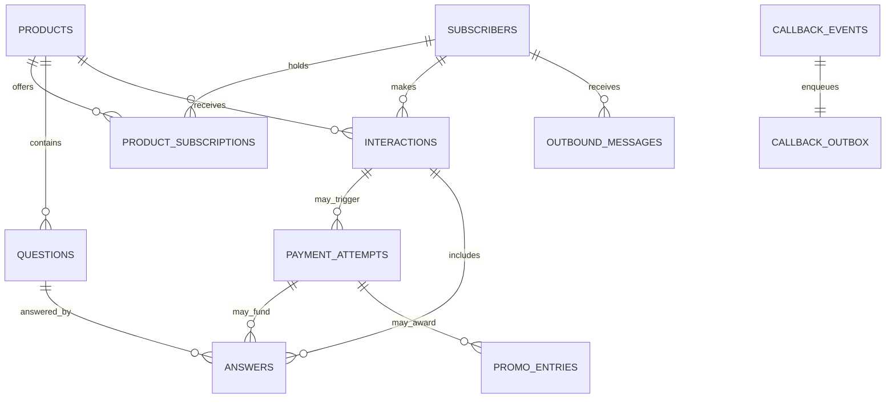

# Schema proposal and migration boundary

`migrations/001_callback_inbox_outbox.sql` is an additive proposed schema for callback receipt and delivery. It is not applied to any database. `docs/schema-proposal.sql` is a conceptual domain schema; **do not execute it** until source columns, keys, meanings, data anomalies, and query plans are verified.

This is a **target design**, not the existing ERD. The live database may have different relationships. Proposed monetary values use integer minor units; this depends on provider amount semantics. Business timestamps use UTC in the new schema while callback response timestamps preserve the legacy local format. Legacy source and ID columns preserve traceability. Product and request identifiers remain strings until their actual formats are catalogued.

Before any migration: export `SHOW CREATE TABLE`, indexes, foreign keys, triggers, procedures, views, server version, row counts by dated table, query plans, duplicate rates, null rates, orphan rates, and data growth. Build a source-to-target mapping for every column; compare record counts, identifiers, totals, samples, and checksums. Rehearse backups and restoration, then decide whether dated tables should remain, become partitions, or be archived. Do not infer that a table is unused from code references alone.
