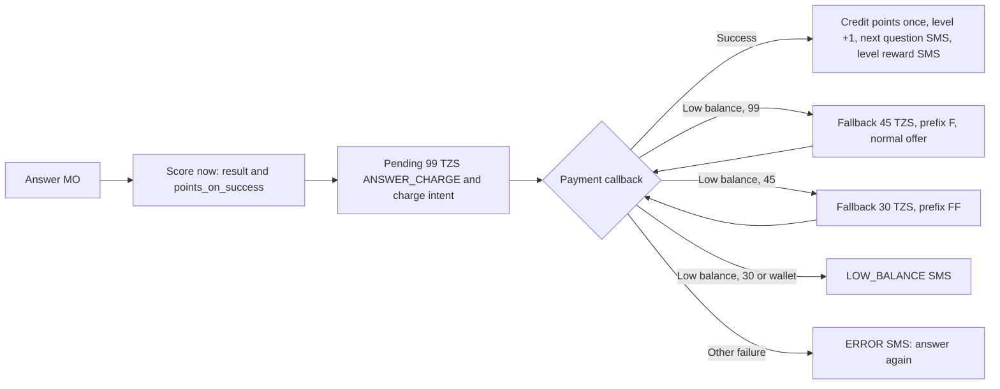

# Soka paid-answer flow

**Reference:** `YAS-SOKA/SokaMoConsumer.php`, the active-subscriber branch from line 1038, and the non-`PU` branches of `SokaPaymentConsumers.php`. The MO consumer's `INACTIVE` block, lines 585–1037, returns on both of its first branches. The answer, credit and charging code after that point inside the block is an older copy that can never run, so it is not the reference.

## Rules carried over from PHP

These are in `internal/workers/sokagame`, with unit tests.

- **Order of checks for an active subscriber's MO:**
  1. Predict-and-Win (`PREDICT`, or `M` followed by digits).
  2. The provider's no-open-question reasons.
  3. Point-purchase keywords, then near-miss keywords, which get the menu.
  4. `ondoa`.
  5. `pointi`, `points` or `point`.
  6. The help words.
  7. `ondoa soka`, `ondoasoka` or `stop`.
  8. **Anything else is an answer and is charged 99 TZS.**
- **When the answer is scored:** at MO time, against the subscription's current question. Matching is case-insensitive for ASCII only, like PHP 8 `strtolower`. A correct answer earns the question's points; a wrong one earns 25. Both double in golden hours, 18:00–23:59 Africa/Dar_es_Salaam, so a wrong answer earns 50. A dated level bonus (`answer_level_bonuses`, formerly `tbl_qn_levels`) for level+1 is added to either.
- **Points are credited only when a charge succeeds,** exactly once per answer (`point_ledger` source `soka-answer:{answer}`). The level rises by one, a random current question becomes the next one, and the next-question SMS is `Unapoint {total}!{question}.`. If today's bonus row for the new level has a message, a `REWARD_MSG` is also sent.
- **Low-balance ladder:**
  - 99 TZS steps down to 45 TZS (request prefix `F`), and 45 TZS to 30 TZS (`FF`).
  - The fallbacks use the normal offer even for BOOM customers, because PHP calls `sendCharging` without a payment type there.
  - A `billingSystem` of `WALLET_ACCOUNT` gets no fallback.
  - At 30 TZS, or for a wallet, the customer receives `LOW_BALANCE`.
- **Other billing failures** send `ERROR_MSG`, which asks the customer to answer again.
- **Point purchases** also raise the level by one, as PHP's `USER_LEVEL+1` does.
- **Keyword replies** are message intents: points uses the ledger balance, plus help and `ondoa`. They never charge.

## Deliberate differences

| PHP | Go | Why |
|---|---|---|
| An ack error or timeout sends `QN_ERROR_MSG` with a new question but leaves `LAST_QN_ID` unchanged, so the next reply is scored against the old question. It also writes `tbl_mo_retry` for a re-charge after 30 or 60 minutes. | The charge dispatcher marks uncertain submissions `NEEDS_REVIEW` and never retries automatically. No retry rows are written. | Automatic retries risk double charging, and PHP's retry publishers are not in any check script. |
| Free-credit and BOOM-credit play: scored immediately, plus a zero-amount BOOM tracking charge. Using a BOOM credit also decrements normal `CREDIT`, which can go negative. | Not ported. These subscribers have no credit columns yet. | Needs the credit data mapping and the BOOM provider contract. |
| Rotating weekday and `string_append` marketing text inside the question SMS. | Omitted. | The content tables are not migrated. Owner decision. |
| Questions picked by `mt_rand(8647, 9717)` over raw IDs. | A random question that is currently valid for the product. | Avoids gaps and expired questions in an ID range. |
| A subscriber with no `LAST_QN_ID` is still scored, always as wrong. | Sent to the dead-letter queue for review. | Should not happen with migrated data. |
| A non-JSON or non-2xx ack is treated as failure, and the text is parsed for `status:1` or `Failed`. | The dispatcher records the HTTP status; the payment callback decides the outcome. | Provider ack fixtures are not yet available. |

## Not ported in this slice

These MOs are acknowledged and left unprocessed. They need their own slices:
- subscription and reactivation (new or inactive subscribers, `SUBSCRIPTION` request types, the `soka` keyword when inactive);
- unsubscription (`ondoa soka` and `stop`, which call the renewal system);
- Predict-and-Win;
- open questions;
- free-credit play.

A charge request (a purchase or an answer) from a missing or inactive subscriber goes to review rather than being dropped.

## Queues

Answer charges settle on the existing `yas.soka.point-purchases` queue, which carries every `soka.Payment`. Its worker now routes `PU` request IDs to the purchase path, and other request IDs to an answer charge if Go created one; anything else is acknowledged as not applicable, as before. The queue name is historical.

## Evidence

- **Unit tests:** `internal/workers/sokagame`.
- **MySQL journey:** `internal/workers/sokamo/answer_integration_test.go` drives both workers through:
  - a correct answer with a level bonus;
  - the 99 → 45 → 30 ladder ending in success;
  - one-time crediting, the level, the next question and the reward;
  - a wrong golden-hour answer;
  - a billing error and the wallet no-fallback rule;
  - the BOOM offer;
  - the keyword replies, and skipped predict, stop and open-question MOs;
  - an unverified segment and a missing current question;
  - intake refusing a second, different callback for a settled charge.
- **Crash test:** `internal/e2e` now has half its customers answer. Every 99 TZS charge fails for low balance and is settled by the 45 TZS fallback while processes are SIGKILLed. Three runs converged with one credit per answer and per purchase.
