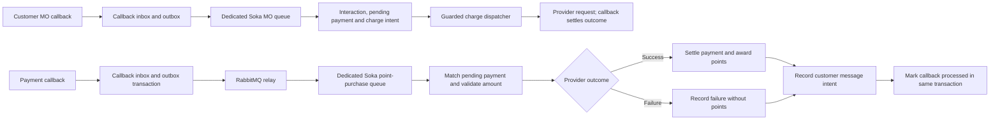

# Soka point-purchase payment path

This is the first isolated Go customer flow. Its reference is `YAS-SOKA/SokaPaymentConsumers.php` (`processMessage`, especially the `PU` branches) and `YAS-SOKA/config.php` (`POINT_PURCHASE_MAP`, `PURCHASE`, `LOW_BALANCE_PURCHASE`, `ERROR_MSG`). The source PHP repository is unchanged.

The new MO worker follows `SokaMoConsumer.php`: exact keywords are case-insensitive after trimming; a similar `P` plus digits keyword receives the menu. It requires an active subscription and verified `NORMAL` or `BOOM` billing segment. The third migration defaults existing subscriptions to `UNVERIFIED` until their source customer type is mapped. The generated payment request ID starts with `PU`, as in PHP, but its exact format must be confirmed with provider contract examples.

The source tier map is TZS 300→300 points, 500→600, 1,000→1,500, 2,000→2,500, and 5,000→10,000. The worker requires an existing `PENDING` `POINT_PURCHASE` payment attempt with the same request ID and subscriber, currency `TZS`, and a known tier. It compares the successful callback's `ChargeAmount` with the stored amount and requires `BillingId`. This makes the whole-TZS assumption explicit; live provider examples must confirm it before production use.

On success, it writes a payment event and point-ledger credit and prepares the legacy purchase message using the new ledger balance. On low-balance failure, it records `LOW_BALANCE_FAILED` and prepares the legacy low-balance message. Other failures become `BILLING_ERROR` with the legacy generic error message. No failed payment earns points. The outcome, message intent, and `processed_events` replay marker commit together. A repeated delivery of the same callback is harmless. Different callbacks that try to settle an already settled attempt go to the dead-letter queue for review.

The worker reads only `soka.Payment` messages on `yas.soka.point-purchases`; other Soka payments are ignored by this specialized worker. The relay declares the durable queue before publishing, so the worker may be offline without losing its copy. Invalid or unreconciled messages go to `yas.soka.point-purchases.dead`; transient database errors leave the delivery unacknowledged and reconnect. The worker queries the callback by broker message ID from MySQL; it does not trust the broker payload for financial posting.

## Remaining before a full customer journey

- Go now creates the `PENDING` attempt and charge intent for exact purchase keywords from active subscribers with a verified billing segment. A guarded dispatcher now builds and submits the legacy-shaped request, but it has only been tested against a fake provider. Real provider contract and callback reconciliation remain open.
- Unknown `P...` keywords create the legacy purchase menu as a message intent and never create a charge. `outbound_messages` records an SMS intent; no SMS delivery worker or provider adapter exists yet.
- The PHP worker increments a mutable subscriber level and updates old answer and daily transaction tables. The target uses an immutable point ledger; answer/level parity and historical data mapping remain open.
- The PHP code defaults to 100 points for an unknown price. Go refuses unknown prices so a malformed or new tier cannot award an unintended amount. Confirm any new tiers before adding them.
- The PHP worker can initiate fallback charges on non-purchase low-balance paths. This worker handles only point purchases and never initiates a charge.
- RabbitMQ end-to-end, real provider contract and timeout reconciliation, and production-like load tests remain outstanding. No production cutover has occurred.
